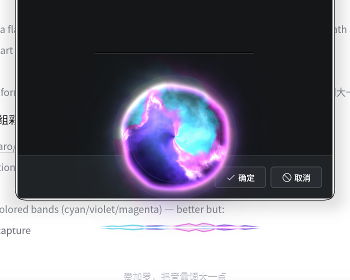

# 费加罗 Figaro

系统级的语音智能助手：DeepSeek 当大脑、本地 ASR 当耳朵、MiniMax 当嗓子，桌面底部一个 Siri 风格的球体当脸。
**不依赖 dsh 运行**——它自己就是一个独立的 Node 守护进程。

```
你 ──说话/按F5──► 唤醒词 KWS + 流式中文 ASR ──文字──► DeepSeek 工具循环（bash/文件/搜索/网页）
                                                              │
桌面球体+波形 ◄── 状态与电平 ◄── IPC ◄── daemon ──句子流式──► MiniMax t2a_v2 ──PCM──► PipeWire
```



## 组成

| 部件 | 位置 | 说明 |
|---|---|---|
| 大脑 | `src/agent/` | DeepSeek `/chat/completions` SSE 流式 + tool_calls 循环；提示词与工具说明从本机 dsh 源码搬用并改写成口语场景 |
| 工具 | `src/agent/tools/` | bash（120s 超时/进程组 kill/尾部截断）、read、write/edit（原子写）、glob、grep、web_search、web_fetch |
| 守护进程 | `src/daemon.js` + `bin/figaro` | 状态机、IPC（`docs/ipc.md`）、边想边说、打断、单实例保护 |
| 耳朵 | `src/voice/asr/` | sherpa-onnx 常驻唤醒词 + 流式/离线中文识别 + VAD 断句；F5 长按走 XDG portal GlobalShortcuts |
| 嗓子 | `src/voice/tts/` | MiniMax `t2a_v2` WebSocket 流式，32k PCM 直喂 `pw-cat`，首字 ≈0.42s，可打断 |
| 脸 | `qml/` | 独立 Quickshell 实例（`qs -c figaro`）：Canvas 绘制的发光球体 + 电平环 + 字幕 |
| 设置/自测 | `settings/` | macOS 风格的独立设置面板（`qs -c figaro-settings`）：灵敏度、误唤醒、环境音抑制、麦克风、语音、识别、诊断 |

## 安装

```bash
./install.sh          # 装 QML overlay、systemd user units（figaro.service / figaro-ui.service）
```

先决条件：
- `~/.config/figaro/config.json`（600 权限，模板见 `config/config.example.json`）填 DeepSeek 与 MiniMax 的 key；
- `npm install`（`sherpa-onnx-node`、`ws`）；
- 模型：`bash scripts/fetch-models.sh`（KWS 4.9M / 流式 ASR 25M / 离线 ASR 233M / VAD 636K，落到 `models/`，不入库）。

## 用法

```bash
figaro ask "现在几点？用 bash 看一下"     # 一问一答（默认不出声）
figaro settings                        # 打开 macOS 风格设置/自测面板（应用菜单里叫「费加罗」）
figaro talk                            # 唤醒一次（不用说话，等同喊「费加罗」）
figaro ask "讲个笑话" --speak            # 出声
figaro say "你好，我是费加罗"             # 只朗读
figaro status                           # 状态/模型/语音能力/最近错误
journalctl --user -u figaro -f          # 看日志
```

语音：
- **长按 F5 ≥0.26s** 说话，松开结束（push-to-talk）；
- 或者直接说 **「费加罗」** 唤醒，然后说你的问题，静音 0.9s 自动结束；
- 点一下桌面上的球体可以打断它。

**热键**：按住 F9 说话，由 `asr.hotkey` 决定。daemon 以 systemd 用户服务运行时，
XDG 的 GlobalShortcuts portal 经常拿不到"服务属于哪个应用"而拒绝建会话（`figaro status` 会显示
`热键: 不可用（unavailable）`）。这种情况有两个可用办法：

1. 让它自己注册：`systemctl --user restart figaro` 后看 `figaro status`，端口会话有时能在重试时建上；
2. **手动绑一个快捷键**（最稳，任何情况下都可用）：KDE 系统设置 → 快捷键 → 添加 → 命令，
   命令填 `figaro talk`，按键设为 F9。点一下等于喊了一次「费加罗」，语音唤醒逻辑完全不变。

注意 `figaro talk` 只负责"唤醒一次"，长按/松开这种 push-to-talk 语义仍由语音唤醒路径负责。

**误唤醒**：默认灵敏度 `low`，且 TTS 出声期间会暂停唤醒词监听（否则助手会听见自己说话而反复唤醒——这正是
最初"一直被触发"的根因）。三档灵敏度的负样本实测见 `src/voice/asr/README.md`：每档 41.8 分钟负样本下真人
语音 0 次误触发；真实录音中的误唤醒全部是 TTS 回声，现已从根上消除。

## 体检：`figaro doctor`

出问题时先跑这一条，不用翻日志：

```bash
figaro doctor            # 只读体检，中文 ✓/✗/! 报告 + 末尾可复制修复命令
figaro doctor --json     # 机器可读（给脚本/设置面板用）
figaro doctor --fix      # 只做安全修复：重启 figaro/figaro-ui、解除 sink 静音、config chmod 600
figaro doctor --net      # 额外做一次 DeepSeek /models 与 MiniMax 极短合成，测真实连通性（默认不联网）
```

检查 10 组，都是本机真实踩过的坑：服务（active/PID/单实例、残留 overlay 抢占）、IPC socket 握手、
配置权限与**掩码后的**密钥、KWS/离线/流式/VAD 模型完整性（自动识别 zh-en 双语 vs legacy 中文）、
麦克风 ALSA Capture 增益（过低/削顶/静音/底噪/parec 取流）、音频出口（tts.sink 是否存在、mute/volume、
pw-cat）、可选网络连通性、KDE 热键绑定（kglobalshortcutsrc）、桌面能力（KOS `SurfaceShape`、
unit 里的 `QML2_IMPORT_PATH`、`qs`/`spectacle`/`ffmpeg`）、资源（显存/overlay CPU/磁盘）。

退出码：有 `✗` 时为 1（便于 `figaro doctor || systemctl --user restart figaro` 之类的脚本），
只有 `!` 警告时为 0。密钥始终只打印掩码（如 `sk-…abcd`），任何情况下都不会输出全文。

## 设置/自测面板

`qs -c figaro-settings`（或应用菜单里的「费加罗设置」）提供六个分区：

| 分区 | 能做什么 |
|---|---|
| 概览 | 服务状态、状态机、四项延迟（唤醒→应答 / TTS 首字 / ASR 最终 / 流式 partial）、语音能力 |
| 唤醒 | 开关、灵敏度三档、防抖冷却、唤醒词、热键重绑、**唤醒测试**（实时 KWS 分数曲线 + 命中/延迟/漏检）、**环境音抑制测试**（统计误唤醒并导出 CSV） |
| 麦克风 | 设备、增益滑块、自动校准、实时电平条与削波警告、底噪测量与建议增益 |
| 语音 | 输出设备、音色试听（首字延迟）、语速、唤醒应答短语 |
| 识别 | 一次录音→流式 vs 离线转写对比、字级正确率、耗时 |
| 诊断 | 路径、重启服务、复制日志、导出诊断 JSON、能力表、最近错误 |

机制：面板与 daemon 之间走 `docs/ipc.md` §3.1 的同一套 socket 协议（`config.get/set`、`test.mic/asr/wake/tts`、
`diagnostics`、`service.restart`）；`settings/test/fake-daemon.mjs` 实现同一协议，可在不碰真实麦克风的
情况下完整演练界面。

## 实测数字（本机 i7-14700KF / RTX 5070 Ti / PipeWire）

| 指标 | 数值 |
|---|---|
| TTS 首字延迟（speak→首段 PCM，真机） | 中位 **208ms**（可闻首字 ≈0.42–0.45s） |
| 语音回合：wake→listening | **0.23s** |
| 语音回合：说话结束→thinking | ≈1.5s（静音判停 0.9s） |
| TTS 打断 `stop()` | 同步 1.9–2.0ms，播放进程退出 5–6ms |
| 长文本不丢句 | 72 字回复本地 ASR 回读 CER 0.0%（4/5 音色） |
| overlay 空闲开销 | 0% CPU / ~39MB（窗口隐藏时不渲染，shader 与波形停止） |
| 唤醒误触发（修复回声后） | **0 次**（连续 15 分钟，真人语音/环境音） |
| 唤醒灵敏度（low/medium/high） | 8/8 命中；真人语音 10 分钟 0 误触发；近音干扰 40 句 3–4 次 |
| 单测 | **237 pass / 0 fail**（ASR 69 + daemon 87 + TTS 81，`/usr/bin/node` v22.22.1，`npm test`） |

## 已知限制

- MiniMax `t2a_v2` 限速 20 RPM，而本设计一句一请求；模块内建 18 RPM 自排队 + 1002 冷却重试。
- 唤醒词常驻监听：空闲 ~2.8–5.5% of one core、RSS 166MB（首次唤醒后加载离线模型 ~627MB）。ORT session 必须
  单线程，双线程会让 onnxruntime 在两帧之间自旋，空闲 CPU 飙到 200%+。
- 本机 16GB 显存被本地大模型占满时，Qt 的 EGL 上下文可能分配失败并把 layer surface 画坏（表现为屏幕顶部一条
  黑线）。overlay 因此改为软件渲染 + Canvas，不再依赖 GL；设置面板同样走软件渲染。
- `web_search` 无 API key，走 Bing HTML + DDG 兜底，可能被反爬限流（失败会如实说没搜到）。
- 唤醒词是中文「费加罗/菲加罗/飞加罗/figaro」，误唤醒率与播放音乐时的表现见 `tests/asr/` 的实测记录。
- 只实现了 PCM 播放路径（服务端确认按 pcm 返回），没有 mp3 解码回退。

## 设计约束

- 不 import 任何 `@deepseek-ai/dsh` 包：提示词/工具 schema 是搬用重写，运行时零依赖关系。
- 密钥只从 `~/.config/figaro/config.json`（600）读，仓库和日志里不出现。
- ASR、TTS 任一模块缺失时 daemon 只 warn 降级，纯文本 `ask` 仍然可用（便于无麦机器/CI）。
- 第三方：`qml/THIRD_PARTY_NOTICES.md`（siriwave MIT）。
