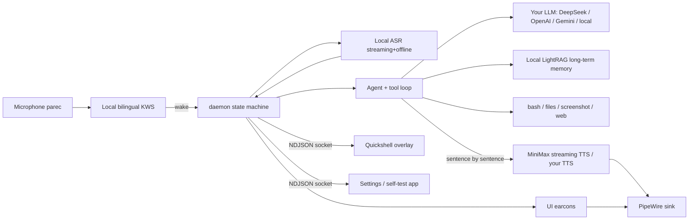

<div align="center">


# Figaro · 费加罗

**A voice assistant that runs on your own Linux desktop. Say the word — it appears. Finish — it leaves.**

[](LICENSE)
[](https://github.com/muzapar00/figaro/releases)
[](#measured-numbers)
[](#quick-start)
[](#architecture)
[](#architecture)

[English](README.md) · [中文](README.zh-CN.md) · [NextKDE integration plan](docs/nextkde-integration.md) · [IPC contract](docs/ipc.md) · [Voice interaction state machine](docs/voice-interaction.md) · [Contributing](CONTRIBUTING.md)

</div>


Figaro is not another chat window. It is a background daemon plus a small overlay that hugs the top edge of your
screen: **say "Figaro" in English or 「费加罗」 in Chinese and it wakes**, acknowledges you out loud, then morphs
the ball into a caption-carrying pill while it answers. When the answer ends it does not vanish — it settles back
into a ball and quietly waits seven seconds in case you want to follow up. Tell it to stand down and it finishes
the last sentence, then leaves.

Wake-word detection and speech recognition run **entirely on this machine**. Conversation and tool use go through
**the LLM provider you choose** (DeepSeek by default); the voice is MiniMax streaming TTS. There is no telemetry and
no server of ours: every key, memory and log stays on your machine — see [docs/privacy.md](docs/privacy.md).

---

## What it does today

| | |
|---|---|
| 🎙️ **Bilingual wake word** | 「费加罗/菲加罗/飞加罗」 and "figaro / hey figaro" on one model; measured 0 false wakes over 10 minutes of real speech |
| 🗣️ **Stops when you stop, waits when it is done** | After the reply it waits seven seconds; just keep talking to follow up — no wake word needed. Only genuinely loud speech counts (floor 0.0023, gate 0.012) |
| 🚪 **Leaves on request** | "退下 / 休息吧 / 没事了" finishes the spoken reply first, then dismisses; tap it to cancel instead |
| 🛑 **Interruptible** | Talk over the answer (loud enough, long enough) and it stops instantly and listens — background noise will not trigger it |
| 🧠 **Remembers across sessions** | Optional long-term memory via a local **LightRAG** service (MIT): related notes are recalled before answering, and exchanges can be indexed in the background. **Auto-ingest is off by default** because indexing sends text to your chosen LLM/embedding provider; if the service is down it silently answers without memory |
| 🖥️ **Sees the screen** | Built-in `screenshot` + `view_image` tools: ask what is on screen and it actually looks (a parameter-name mismatch that used to make it report "the image tool is broken" is fixed) |
| 🛠️ **Local tools** | bash, read/write files, glob/grep, web search — composable |
| 🔊 **Quiet UI sounds** | Five 65–200 ms earcons (wake, capture end, answer done, dismiss, error), 4–6 dB below the voice, separate processes that can never interrupt speech |
| 🎨 **Configurable appearance** | Scale 0.5–2.0, shape (ball ↔ pill / always ball / a line), motion off; real KWin liquid glass on KDE |
| 🌐 **Three languages, guided setup** | Settings and the 9-step onboarding wizard are available in **简体中文 / 繁體中文 / English**; the wizard explains what Figaro does, the privacy model, language/region, API keys and self-tests in plain, large text |
| 🔌 **Bring your own LLM** | DeepSeek, OpenAI, Gemini, or any OpenAI-compatible endpoint (including local Ollama/vLLM); switch provider/model in settings and test the connection. Old `deepseek.*` configs keep working |
| 🌏 **Region-aware model download** | Mainland China picks domestic mirrors automatically (ModelScope / hf-mirror / ghproxy with fallback); 中国港澳台 and overseas use official sources. `scripts/fetch-models.sh --probe --region …` shows the exact source |
| 📦 **Linux packages** | deb (Ubuntu/Kubuntu/KDE neon), AUR (Arch), rpm (Fedora/openSUSE) built by CI on every release tag; see [Platform support](docs/platform-support.md) |
| 🔒 **Private by construction** | No telemetry, no account, no server of ours; wake word, ASR and voiceprint are local; keys stay in a 600 file; details in [docs/privacy.md](docs/privacy.md) |
| 🧭 **Guided self-test** | A five-step wizard in the settings app: quiet room → gain → wake word → dictation → voice |
| 🩺 **One-command health check** | `figaro doctor` checks services, models, keys, microphone, audio sink, hotkey, desktop capabilities and resources |

<p align="center"></p>

---

## Quick start

**Requirements**: Linux + Wayland. **KDE Plasma 6 Wayland is the officially supported target**; Hyprland/sway are
experimental (see [Platform support](docs/platform-support.md)). You need [Quickshell](https://github.com/quickshell-mirror/quickshell)
(`qs` on `PATH`), Node ≥ 22, PipeWire and Python 3. KWin liquid glass is **optional** — without the KOS plugin the
overlay falls back to a translucent fill and keeps working.

### Install (v1.0)

| Distribution | Command |
|---|---|
| Ubuntu / Kubuntu / KDE neon 26.04 | download `figaro_1.0.0_amd64.deb` from the release, `sudo apt install ./figaro_1.0.0_amd64.deb`, then launch **费加罗** once |
| Arch / EndeavourOS | `yay -S figaro` (AUR) — or build from `packaging/aur/PKGBUILD` |
| Fedora / openSUSE | download the `figaro-1.0.0-*.rpm` from the release and install it |
| Any distro (source) | `git clone … && ./install.sh` (see below) |

Packages install the app and systemd-user units; the **first launch opens the guided setup** (install-user + wizard)
and never overwrites an existing config. Models are downloaded on first run (region chosen in the wizard).

```bash
git clone https://github.com/muzapar00/figaro.git && cd figaro

# 1. Dependencies + install (creates a config scaffold if missing; never overwrites keys)
npm install
./install.sh

# 2. Open the settings app and finish the guided setup:
#    language → region → long-term memory → LLM key → MiniMax key → self-test
#    (models are downloaded inside the wizard; CLI equivalent:)
bash scripts/fetch-models.sh --region=mainland   # or hmt / overseas

# 3. Try it
figaro ask "What time is it? Use bash." --speak
```

> Settings app: **费加罗** in the application menu, or `figaro settings`.
> Health check: `figaro doctor`; status: `figaro status`.

**How to talk to it**
- Say **"figaro"** (or 「费加罗」); press-and-hold F9 also works, see [Troubleshooting](#troubleshooting).
- About 0.9 s of silence ends your sentence; tap the overlay or short-press the key to cancel.
- "取消 / 算了 / 别说了" makes it stop talking; "退下 / 休息吧 / 没事了" dismisses it.

---

## Interaction (Siri-style state machine)

| State | Trigger | Visual | Sound |
|---|---|---|---|
| `idle` | normal | nothing rendered (0% CPU) | — |
| `waking` | wake word / hotkey | ball drops in from the top edge | earcon + one of 10 random acknowledgements |
| `listening` | microphone opens together with the ack | ball breathes with the level, level rings | you |
| `finalizing` / `thinking` | 0.9 s of silence | violet light arcs | very quiet capture-end tick |
| `speaking` | answer starts | ball stretches into a captioned pill | streaming voice, sentence by sentence |
| `waiting` | answer finished | ball again, waits seven seconds | warm closing note; resumes on speech |
| dismiss / cancel | "退下" / tap / short press | collapses into the ball, then withdraws | falling tone |

Motion follows Apple's HIG: one idea per state, cancellable, gesture-following, respects reduced motion.
The full rules and measurements are in [`docs/motion.md`](docs/motion.md).

---

## Architecture



| Path | Contents |
|---|---|
| `src/daemon.js` | state machine, wake/cancel/waiting window, barge-in, IPC server |
| `src/agent/` | DeepSeek streaming client, tool loop, system prompt, 8+ tools |
| `src/voice/asr/` | resident wake word, VAD, offline/streaming ASR, hotkey, gain calibration |
| `src/voice/tts/` | MiniMax streaming synthesis, PCM playback, voice/sink resolution |
| `src/voice/sfx/` | UI earcons (short, never through the TTS path) |
| `qml/figaro/` | overlay: ball/pill/line, liquid glass, captions, motion |
| `settings/` | macOS-style settings and self-test GUI (Quickshell) |
| `docs/` | IPC contract, voice state machine, motion rules, NextKDE migration plan |

**Design constraints**: no runtime dependency on any `@deepseek-ai/dsh` package (prompts and tool schemas were
reimplemented); if ASR or TTS is missing the daemon degrades and plain-text `ask` still works; keys are read only from
`~/.config/figaro/config.json` (mode 600) and never appear in the repo, logs or screenshots.

---

## Measured numbers

Host: i7-14700KF / RTX 5070 Ti / PipeWire / Plasma 6.6 / Node 22.22.

| Metric | Value |
|---|---|
| Wake word → acknowledgement audible | ≈0.9 s (the microphone opens while the ack is *playing*, ~0.7 s faster than waiting for it) |
| End of speech → first audio | 1.2–1.8 s (first model token 0.6–0.9 s + TTS first packet ≈0.35 s) |
| Bilingual wake recall | Chinese 8/8, English external TTS 20/20; median detection 900 ms |
| False wakes | 0 in 10 minutes of human Chinese speech; 2/40 adversarial near-homophones (0/40 with two-stage verification on, at +600 ms per wake, off by default) |
| Wake acknowledgements | 10 phrases, random without immediate repeats; 10 pre-synthesised in 1.94 s (3 at a time) |
| Follow-up window | 7 s, gate 0.012 RMS for 180 ms (measured floor 0.0023, normal speech median 0.036) |
| Barge-in | requires ≥0.09 RMS and clearly above the playback echo baseline for 500 ms; 0 echo-triggered interruptions |
| UI earcons | 5 sounds, 65–200 ms, 4–6 dB below the voice |
| Overlay cost | visible: 30 fps GPU ≈18% of one core (software rasteriser 35.4%); hidden: 0% |
| Unit tests | **316 pass / 0 fail** |

---

## Configuration cheat sheet

Everything lives in `~/.config/figaro/config.json`, and most of it can also be changed from the settings app
(which tells you whether a change applied instantly or needs a restart).

| Key | Default | Meaning |
|---|---|---|
| `asr.sensitivity` | `low` | three wake-word sensitivity levels (measured numbers in the settings app) |
| `asr.hotkey` | `F9` | hold to talk / tap to cancel |
| `asr.silenceStopMs` | `3000` | how much silence ends a sentence (900 ms cut people off mid-sentence) |
| `asr.speaker` | `{enabled:false, threshold:0.65}` | voiceprint: after `figaro enroll-voice`, only your voice can wake it |
| `rag.enabled` / `rag.host` | `true` / `http://127.0.0.1:9621` | local LightRAG long-term memory (MIT, see [docs/rag.md](docs/rag.md)) |
| `rag.timeoutMs` / `rag.autoIngest` | `1500` / `false` | recall budget; auto-indexing is opt-in (it sends text to your LLM/embedding provider) |
| `home.haUrl` / `home.haToken` | unset | local Home Assistant REST endpoint + long-lived token; enables the `home` tool (lights) |
| `asr.bargeIn` | `{enabled:true, minRms:0.09, echoFactor:2.5, minMs:500}` | how loud a voice must be to interrupt |
| `asr.verifyWake` | `{enabled:false, timeoutMs:1800}` | two-stage wake verification (0/40 false wakes, +600 ms per wake) |
| `asr.modelDir` | `null` | custom wake/ASR model directory; bundled models by default |
| `interaction.followUpWindowMs` | `7000` | how long it waits for a follow-up; 0 = leave immediately |
| `interaction.followUpMinRms` / `MinMs` | `0.012` / `180` | what counts as "you are talking" |
| `interaction.dismissPhrases` | 退下 / 休息吧 / 没事了 … | ways to tell it to stand down |
| `interaction.cancelPhrases` | 取消 / 算了 / 别说了 … | ways to interrupt it |
| `tts.voiceId` | `male-qn-jingying` | MiniMax voice; five shipped options in the settings app |
| `tts.ack.phrases` | 10 phrases | wake acknowledgements, random without repeats |
| `sfx.enabled` / `sfx.volume` | `true` / `0.35` | UI earcons |
| `ui.scale` / `ui.shape` / `ui.motion` | `1.0` / `orb` / `auto` | appearance: size, shape (orb/ball/line), motion off |
| `llm.provider` / `llm.baseUrl` / `llm.model` / `llm.apiKey` | `deepseek` / provider default / `deepseek-flash` / — | LLM provider: `deepseek`, `openai`, `gemini` or `custom` (OpenAI-compatible). Legacy `deepseek.*` is still read |
| `models.region` | `mainland` \| `hmt` \| `overseas` | model download region (domestic mirrors vs official sources); set by the wizard |
| `minimax.apiKey` | — | MiniMax TTS key; local config only, the settings app writes but never reads it back |
| `llm.apiKey` | — | same rule: write-only, masked as `***` on read |

---

## Troubleshooting

**Start with `figaro doctor`** — it checks services, IPC, masked keys, model completeness, microphone gain/level/noise
floor, audio sink and mute state, hotkey binding, the KWin glass plugin, VRAM/CPU/disk, and prints copy-pasteable fixes.

| Symptom | Fix |
|---|---|
| The settings app asks for an LLM key I do not have | use **DeepSeek** (cheapest for this workload), OpenAI or Gemini via the provider cards, or point `llm.baseUrl` at a local OpenAI-compatible server (Ollama/vLLM). Figaro cannot ship its own hosted LLM — see [docs/llm-providers.md](docs/llm-providers.md) |
| Model download is slow or blocked | choose the right region in the wizard (mainland vs 中国港澳台/overseas); check the sources with `scripts/fetch-models.sh --probe --region=mainland` |
| UI is in the wrong language | settings → Appearance → Language (简体中文 / 繁體中文 / English), or set `LANG` before the first launch |
| My settings window crashes on launch | the default is now the OpenGL backend; if you forced software (`FIGARO_SETTINGS_GL=0`), unset it |
| No sound | `tts.sink` points at a muted or unconnected sink; `figaro doctor` names it, or pick the output device in settings. The daemon and the earcons share one sink |
| Wake word does nothing | try `medium/high` sensitivity; check `asr.inputGainPercent` against the live level in `figaro doctor`; make sure the KWS model is downloaded |
| Music / TV wakes it up | record your voiceprint once with `figaro enroll-voice`; after that the wake audio is matched against your voice (config `asr.speaker`) |
| It forgets yesterday | long-term memory is the local LightRAG service: `systemctl --user status figaro-rag figaro-rag-embed`, see [docs/rag.md](docs/rag.md) |
| False wakes from TV or music | enable `asr.verifyWake.enabled` (near-homophone false wakes 2/40 → 0/40, at +600 ms per wake) |
| F9 does not work | the portal is still starting, or the session predates the login. The daemon retries for ~50 s and then re-checks every minute, so give it a moment or restart `figaro`. If it never binds, the portal cannot resolve the app id: KDE System Settings → Shortcuts → add the command `figaro talk`, bind F9 |
| Nothing happens after logging out and back in | expected for a couple of seconds: the units follow `graphical-session.target`, so the daemon stops on logout and comes back once PipeWire and the portal are ready (≈3–10 s). `systemctl --user status figaro figaro-ui`, then `systemctl --user restart figaro figaro-ui` if it is still down |
| It ignores "退下" | check `interaction.dismissPhrases`; it deliberately finishes the current reply before leaving |
| No sound after plugging in headphones | change `tts.sink` or set it empty (system default); the settings app can switch it live |

---

## Roadmap

- **NextKDE / portable UI**: rewrite the settings window on the `Kos.Ui` components and ship it as a NextKDE app,
  with the overlay and daemon as local sidecars. Research and a staged plan in [`docs/nextkde-integration.md`](docs/nextkde-integration.md).
- Deeper non-KDE support: GNOME Wayland needs a layer-shell extension; Hyprland/sway need community testing
  (see [Platform support](docs/platform-support.md)). Windows/macOS need a separate UI/audio/hotkey port — not planned for 1.x.
- Flatpak feasibility, and community translations beyond 简体中文/繁體中文/English.
- One-switch Chinese/English mixed ASR, and an optional "continue" that resumes an interrupted answer.

---

## Licence and credits

- Code is released under **GPL-3.0-or-later**, see [`LICENSE`](LICENSE). Third-party code, models and network services
  are documented in [`THIRD_PARTY_NOTICES.md`](THIRD_PARTY_NOTICES.md).
- Wake-word and recognition models are published by [sherpa-onnx](https://github.com/k2-fsa/sherpa-onnx)
  (Apache-2.0) and downloaded by `scripts/fetch-models.sh`; they are not bundled.
- The overlay host is [Quickshell](https://github.com/quickshell-mirror/quickshell) (LGPL-3.0, runtime dependency).
- Motion was informed by Apple's HIG and by siriwave (MIT); earcons and icons are generated by scripts in this repo.
- Please report security issues privately as described in [`SECURITY.md`](SECURITY.md); read [`CONTRIBUTING.md`](CONTRIBUTING.md)
  before contributing.

<div align="center"><sub>Figaro — for people who want to keep control of their own computer.</sub></div>
