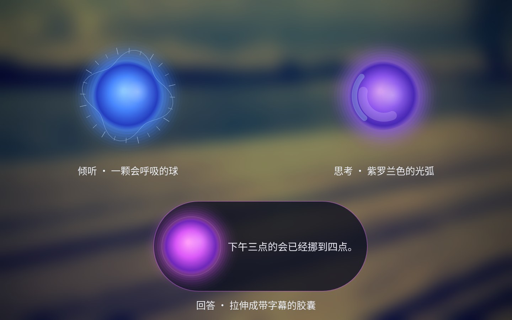
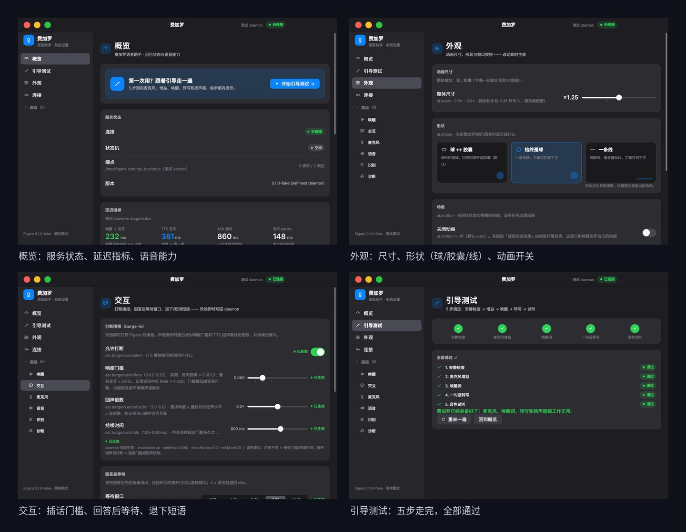
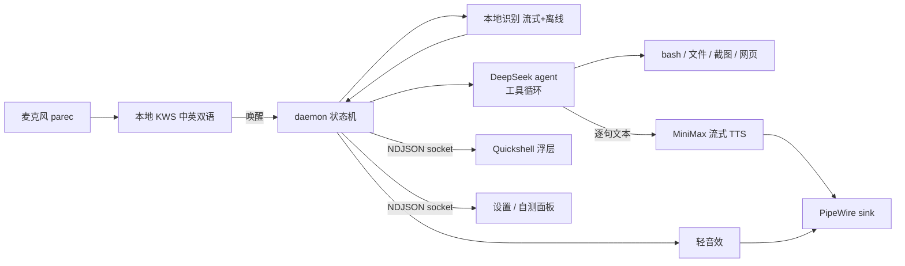

<div align="center">


# 费加罗 · Figaro

**跑在你自己 Linux 桌面上的语音助手：喊一声，它出现；说完事，它退下。**

[](LICENSE)
[](https://github.com/muzapar00/figaro/releases)
[](#实测数字)
[](#快速开始)
[](#架构)
[](#架构)

[中文](README.zh-CN.md) · [English](README.md) · [NextKDE 集成计划](docs/nextkde-integration.md) · [IPC 契约](docs/ipc.md) · [语音交互状态机](docs/voice-interaction.md) · [贡献](CONTRIBUTING.md)

</div>



费加罗不是"又一个聊天窗口"。它是一个常驻后台的助手进程 + 一块贴在屏幕顶部的浮层：
**中文喊「费加罗」或英文喊 "figaro" 都会醒**，醒来先应你一句；回答时球会被拉成带字幕的胶囊，
答完不急着消失，而是停在屏幕上安静等你 7 秒；你说「退下」，它会先把最后一句说完再退。

唤醒词与语音识别**全部本地运行**；对话、工具调用走 DeepSeek；声音是 MiniMax 的流式男声。

---

## 它现在能做什么

| | |
|---|---|
| 🎙️ **中英双语唤醒** | 中文「费加罗/菲加罗/飞加罗」与英文 "figaro / hey figaro" 同一套模型；误唤醒实测 0（真人语音 10 分钟） |
| 🗣️ **说完就停、答完等你** | 回答播完停在屏幕顶部 7 秒，期间直接用正常音量接着说即可追问，不用再喊唤醒词；只有够响的人声才算（底噪 0.0023，门槛 0.012） |
| 🚪 **会自己退下** | 说「退下/休息吧/没事了」→ 先把话说完、语音播完，再收起；也可以点它一下取消 |
| 🛑 **能被打断** | 回答中你开口（够响且持续）就立刻停声转听，不会把环境音当指令 |
| 🧠 **跨会话记忆** | 可选的本地 **LightRAG**（MIT）长期记忆：回答前检索相关旧内容，可后台入库。**自动入库默认关闭**（入库会把文本发给你配置的 LLM/Embedding 服务商）；服务挂了就静默按无记忆回答 |
| 🖥️ **看得见屏幕** | 内置 `screenshot` + `view_image` 工具，问"屏幕上是什么"它真的会看（已修复参数名导致"看图工具坏了"的坑） |
| 🛠️ **本机工具** | bash、读写文件、glob/grep、网页搜索；都能组合使用 |
| 🔊 **不抢语音的音效** | 5 个 65–200ms 的轻音效（唤醒/采集结束/答完/退下/错误），比语音低 4–6 dB，独立进程播放，绝不会打断说话 |
| 🎨 **可调的外观** | 尺寸 0.5–2.0、形状（球↔胶囊 / 始终球 / 一条线）、关闭动画；KDE 上还有 KWin 液态玻璃 |
| 🌐 **三语 + 引导设置** | 设置与 9 步新手引导支持 **简体中文 / 繁體中文 / English**；引导用大字通俗说明"费加罗是什么、要做什么"、隐私、语言/地区、API key 与自检 |
| 🔌 **自带 LLM** | DeepSeek、OpenAI、Gemini，或任意 OpenAI 兼容端点（含本地 Ollama/vLLM）；可在设置里切换 provider/模型并测试连接，旧 `deepseek.*` 配置继续兼容 |
| 🌏 **按地区选模型源** | 中国大陆自动走国内源（ModelScope / hf-mirror / ghproxy，失败自动回退）；中国港澳台/海外走官方。`scripts/fetch-models.sh --probe --region …` 可查看实际源 |
| 📦 **Linux 安装包** | deb（Ubuntu/Kubuntu/KDE neon）、AUR 就绪的 Arch 包、rpm（Fedora/openSUSE），CI 在每次 release tag 自动构建；见 [平台支持](docs/platform-support.md) |
| 🔒 **隐私优先** | 无遥测、无账号、没有我们的服务器；唤醒/ASR/声纹全本地；Key 只在本机 600 文件；详见 [docs/privacy.md](docs/privacy.md) |
| 🧭 **引导式自测** | 设置面板里五步向导：安静检查 → 增益 → 唤醒 → 转写 → 试听，跟着点就行 |
| 🩺 **一键体检** | `figaro doctor` 检查服务/模型/密钥/麦克风/音频出口/热键/桌面能力/资源 |

<p align="center"></p>

---

## 快速开始

**前置**：Linux + Wayland。**正式支持 KDE Plasma 6 Wayland**；Hyprland/sway 实验性支持（见 [平台支持](docs/platform-support.md)）。
需要 [Quickshell](https://github.com/quickshell-mirror/quickshell)（`qs` 在 PATH）、Node ≥ 22、PipeWire、Python 3。
KWin 液态玻璃是**可选**的：没有 KOS 插件时会自动退回半透明底，不影响使用。

### 安装（v1.0）

| 发行版 | 命令 |
|---|---|
| Ubuntu / Kubuntu / KDE neon 26.04 | 从 Release 下载 `figaro_1.0.0_amd64.deb`，`sudo apt install ./figaro_1.0.0_amd64.deb`，然后从菜单打开**费加罗**一次 |
| Arch / EndeavourOS | 用 Release 里的 AUR 包资产（`*.pkg.tar.zst` / `PKGBUILD`）；AUR 上架待推送，也可用 `packaging/aur/PKGBUILD` 本地构建 |
| Fedora / openSUSE | 从 Release 下载 `figaro-1.0.0-*.rpm` 安装 |
| 任意发行版（源码） | `git clone … && ./install.sh`（见下） |

安装包只装程序和 systemd user units；**第一次启动会打开引导设置**（install-user + 向导），不会覆盖已有配置。
模型在首次运行时按地区下载。

```bash
git clone https://github.com/muzapar00/figaro.git && cd figaro

# 1. 配置（唯一需要你填的东西）
mkdir -p ~/.config/figaro
cp config/config.example.json ~/.config/figaro/config.json
chmod 600 ~/.config/figaro/config.json
$EDITOR ~/.config/figaro/config.json      # 填 DeepSeek 与 MiniMax 的 API Key

# 2. 依赖 + 本地模型（唤醒词/识别模型不随仓库分发）
npm install
bash scripts/fetch-models.sh

# 3. 安装并启动（浮层 + daemon + 设置页 + 图标 + 快捷键规则）
./install.sh

# 4. 试试
figaro ask "现在几点？用 bash 看一下" --speak
```

> 设置面板：应用菜单里的 **费加罗**，或 `figaro settings`。
> 体检：`figaro doctor`；状态：`figaro status`。

**唤醒方式**
- 直接说 **「费加罗」** 或 **"figaro"**（长按 F9 也支持，见[疑难排查](#疑难排查)）；
- 说完停顿约 0.9 秒自动结束，也可以再按一次 / 点它取消；
- 想让它闭嘴说「取消 / 算了 / 别说了」；想让它离开说「退下 / 休息吧 / 没事了」。

---

## 交互长什么样（Siri 规则）

| 状态 | 触发 | 视觉 | 声音 |
|---|---|---|---|
| `idle` | 平时 | 不渲染（0% CPU） | — |
| `waking` | 唤醒词/热键 | 球从屏幕顶部落下 | 轻音效 + 10 句随机应答（我在/你好/嘿/有何贵干…） |
| `listening` | 应答同时开麦 | 球随音量呼吸，有电平环 | 你说 |
| `finalizing` / `thinking` | 停口 0.9s 后 | 紫罗兰光弧旋转 | 极轻的采集结束音 |
| `speaking` | 回答开始 | 球被拉成胶囊，字幕在右 | 流式男声（逐句合成，边说边播） |
| `waiting` | 回答播完 | 收成球，停在顶部 7 秒 | 柔和收尾音；听到你说话就回到 `listening` |
| 退下/取消 | 说「退下」/点它/短按 F9 | 收成球后上收消失 | 下降音 |

动效遵循 Apple HIG：同一时刻只有一个主旨动作、可被取消、跟随手势、支持"减弱动态效果"；
完整规则和实测数字见 [`docs/motion.md`](docs/motion.md)。

---

## 架构



| 目录 | 内容 |
|---|---|
| `src/daemon.js` | 状态机、唤醒/取消/等待窗口、打断、IPC 服务 |
| `src/agent/` | DeepSeek 流式客户端、工具循环、系统提示词、8+ 个工具 |
| `src/voice/asr/` | 常驻唤醒词、VAD、离线/流式识别、热键、增益校准 |
| `src/voice/tts/` | MiniMax 流式合成、PCM 播放、音色/sink 解析 |
| `src/voice/sfx/` | UI 音效（短音，不经过 TTS） |
| `qml/figaro/` | 浮层：球/胶囊/线、液态玻璃、字幕、动效 |
| `settings/` | macOS 风格设置与自测 GUI（Quickshell） |
| `docs/` | IPC 契约、语音状态机、动效规则、NextKDE 移植计划 |

**设计约束**：不依赖任何 `@deepseek-ai/dsh` 运行时包（提示词/工具 schema 是搬用重写）；ASR/TTS 任一缺失就降级，
纯文本 `ask` 始终可用；密钥只从 `~/.config/figaro/config.json`（600）读，仓库/日志/截图里不出现。

---

## 实测数字

测试机：i7-14700KF / RTX 5070 Ti / PipeWire / Plasma 6.6 / Node 22.22。

| 指标 | 数值 |
|---|---|
| 唤醒→应答出声 | ≈0.9s（应答开播的同时麦克风就已打开，比"等应答播完"快约 0.7s） |
| 说完→首段语音 | 1.2–1.8s（模型首字 0.6–0.9s + TTS 首包 ≈0.35s） |
| 中英双语唤醒 | 中文 8/8、英文外部 TTS 20/20；检测中位 900ms |
| 误唤醒 | 真人中文语音 10 分钟 0 次；近音对抗句 2/40（开启两段式校验后 0/40，代价 +600ms/次，默认关） |
| 唤醒应答 | 10 句随机不重复；启动预合成 10 句 3 并发 1.94s |
| 回答后等待窗口 | 7s，门槛 0.012 RMS / 180ms（实测底噪 0.0023、正常说话中位 0.036） |
| 打断（barge-in） | 需响度 ≥0.09 且明显高于回声基线，持续 500ms；回声误触发 0 次 |
| UI 音效 | 5 个，65–200ms，比语音低 4–6 dB |
| 浮层开销 | 可见时 GPU 渲染 30fps ≈18% 单核（软件栅格化 35.4%）；隐藏时 0% |
| 单测 | **316 pass / 0 fail** |

---

## 配置速查

所有可调项都在 `~/.config/figaro/config.json`，也可以直接在设置面板里改（标注了是否热生效）。

| 键 | 默认 | 说明 |
|---|---|---|
| `asr.sensitivity` | `low` | 唤醒灵敏度三档（实测数据见设置页） |
| `asr.hotkey` | `F9` | 长按说话 / 短按取消 |
| `asr.bargeIn` | `{enabled:true, minRms:0.09, echoFactor:2.5, minMs:500}` | 插话打断门槛 |
| `asr.verifyWake` | `{enabled:false, timeoutMs:1800}` | 两段式唤醒校验（误唤醒压到 0，代价 +600ms） |
| `asr.modelDir` | `null` | 自定义唤醒/识别模型目录，默认用仓库自带 |
| `interaction.followUpWindowMs` | `7000` | 回答后等待追问的时长；0 = 答完即退 |
| `interaction.followUpMinRms` / `MinMs` | `0.012` / `180` | 什么算"你在说话" |
| `interaction.dismissPhrases` | 退下/休息吧/没事了… | 让它退下的说法 |
| `interaction.cancelPhrases` | 取消/算了/别说了… | 打断并回到待机 |
| `tts.voiceId` | `male-qn-jingying` | MiniMax 男声，设置面板可选 5 个实测音色 |
| `tts.ack.phrases` | 10 句 | 唤醒应答短语，随机不重复 |
| `sfx.enabled` / `sfx.volume` | `true` / `0.35` | UI 音效开关与音量 |
| `ui.scale` / `ui.shape` / `ui.motion` | `1.0` / `orb` / `auto` | 外观：尺寸、形状（orb/ball/line）、关动画 |
| `deepseek.apiKey` / `minimax.apiKey` | — | 只在本地配置文件里；设置里只写不读 |

---

## 疑难排查

**先跑 `figaro doctor`**——它能查服务、IPC、密钥掩码、模型完整性、麦克风增益/电平/底噪、音频出口与静音、
热键绑定、KWin 玻璃插件、显存/CPU/磁盘，并在末尾给出可复制的修复命令。

| 症状 | 处理 |
|---|---|
| 没声音 | `tts.sink` 指向了被静音/接不到喇叭的 sink；`figaro doctor` 会指出来，或设置里换输出设备。注意：daemon 和音效用同一个 sink |
| 注销再登录后没反应 | 正常要等 3–10 秒：两个服务都跟着图形会话走，注销时停、登录后等 PipeWire 和 portal 就绪再起。先 `systemctl --user status figaro figaro-ui`，还没起来就 `systemctl --user restart figaro figaro-ui` |
| 喊了没反应 | 灵敏度调到 `medium/high`；检查 `asr.inputGainPercent` 与 `figaro doctor` 里的实时电平；确认 KWS 模型已下载 |
| 经常被电视/音乐误唤醒 | 打开 `asr.verifyWake.enabled`（近音误唤醒 2/40 → 0/40，代价每次唤醒多约 600ms） |
| F9 用不了 | daemon 作为 systemd 用户服务时 XDG portal 常拿不到 app id。最稳做法：KDE 系统设置 → 快捷键 → 添加命令 `figaro talk`，绑 F9 |
| 说「退下」不理我 | 检查 `interaction.dismissPhrases`；它需要先把当前回答播完才会退 |
| 插入耳机后没声 | 换 `tts.sink` 或设空（系统默认）；改完 `figaro settings` 里可直接切换 |

---

## 路线图

- **NextKDE / 可移植 UI**：把设置窗口用 `Kos.Ui` 组件重写、作为 NextKDE 应用发布，浮层与 daemon 作为本地
  sidecar 继续服务。调研与分阶段计划见 [`docs/nextkde-integration.md`](docs/nextkde-integration.md)。
- 跨发行版打包（AUR / Flathub 可行性）、无 KDE 桌面的材质退化方案。
- ASR 中英混合识别一键切换、可选的"继续说"（被打断后接上剩余回答）。

---

## 许可证与致谢

- 代码以 **GPL-3.0-or-later** 发布，见 [`LICENSE`](LICENSE)；第三方作品、模型与网络服务的许可说明见
  [`THIRD_PARTY_NOTICES.md`](THIRD_PARTY_NOTICES.md)。
- 语音识别/唤醒词模型由 [sherpa-onnx](https://github.com/k2-fsa/sherpa-onnx) 发布（Apache-2.0），
  脚本在 `scripts/fetch-models.sh` 中下载，不随仓库分发。
- 浮层宿主是 [Quickshell](https://github.com/quickshell-mirror/quickshell)（LGPL-3.0，运行时依赖）。
- 动效参考了 Apple HIG 与 siriwave（MIT）；音效与图标由仓库内脚本生成。
- 安全问题请按 [`SECURITY.md`](SECURITY.md) 私下报告；参与贡献前请读 [`CONTRIBUTING.md`](CONTRIBUTING.md)。

<div align="center"><sub>费加罗（Figaro）——给愿意自己掌控电脑的人。</sub></div>
